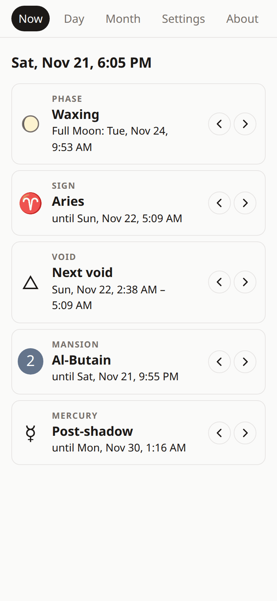
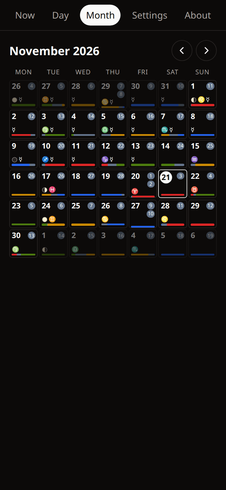
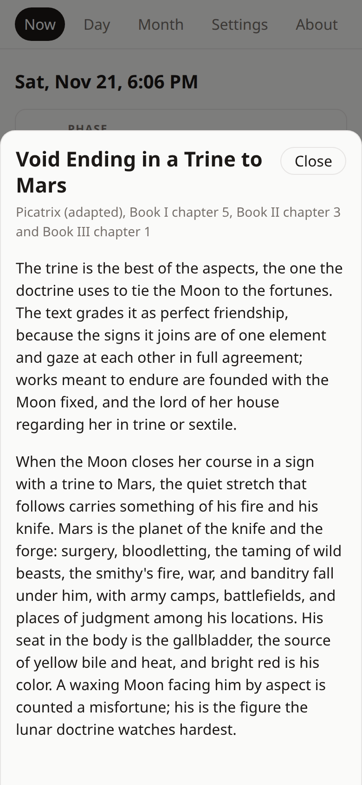
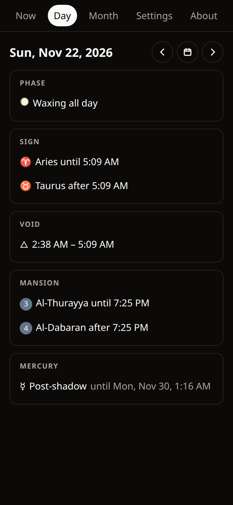
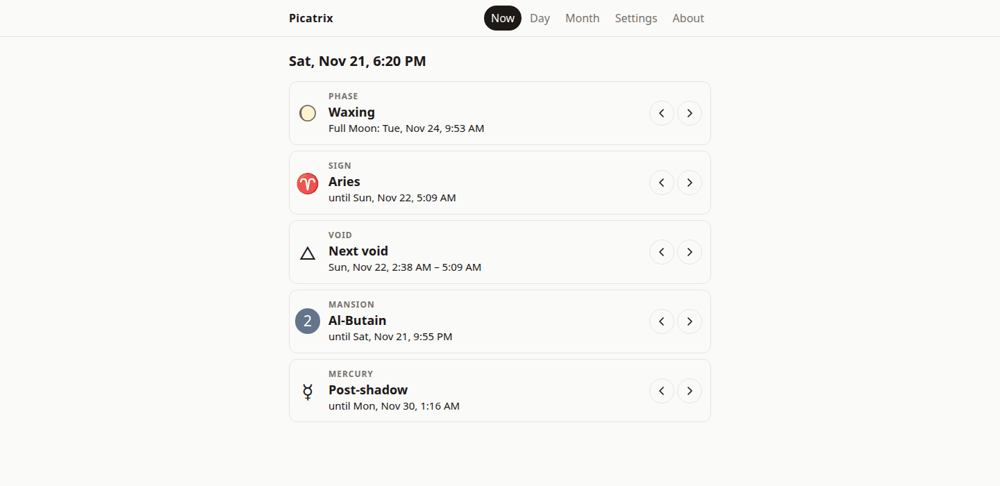

# Picatrix Lunar Almanac

Open the app: [bikemazzell.github.io/picatrix](https://bikemazzell.github.io/picatrix/)

Picatrix shows what the Moon is doing now, on any day, and across any month from 1900 to 2100. Tap any item to read what the *Picatrix*, an 11th-century Arabic book on astral magic, says about it.

<p>
  
  
  
  
</p>



## What it shows

The app follows five things:

- Moon phase: waxing or waning, and the time of the next New Moon, First Quarter, Full Moon, or Last Quarter.
- Sign: the zodiac sign of the Moon, and the time it moves to the next sign.
- Void of course: the hours after the Moon makes its last aspect in a sign and before it enters the next sign. Traditional astrology avoids starting things in these hours.
- Mansion: which of the 28 lunar mansions the Moon is in. The mansions are the traditional Arabic division of the Moon's path.
- Mercury: whether Mercury is direct, in pre-shadow, retrograde, or in post-shadow.

## How to use it

Now shows one card for each of the five items, for the current moment. Use the arrows on a card to step that card to its previous or next change. Select "Back to now" to return all cards to the present.

Day lists every change during one day, with times in your time zone. Use the arrows to move one day, or the calendar button to jump to a date.

Month shows a calendar. Each day shows its date, its mansion numbers, small symbols for Moon phases, sign changes, and Mercury retrograde, and a colored bar. The bar shows the element of the Moon's sign through the day: red for fire, green for earth, yellow for air, blue for water, and gray for void of course. Today has a violet outline and its date in a violet circle. Select a day to open it in Day.

Select any card or row to open its lore. Close the lore with the Close button, the Escape key, or a tap outside it.

In Settings, you choose the time zone, the clock (12-hour or 24-hour), the text size, and the theme. You also choose which of the five items to show.

## Install it on your phone

1. Open the app link in your phone browser.
2. Open the browser menu and select "Add to Home Screen".
3. Open Picatrix from your home screen.

After the first load, the app works with no internet connection.

## Privacy

The app has no server and no account. It does not ask for your location: it uses only the time zone you choose. Your settings stay in your browser. After the first load, the app sends no network requests.

## Where the texts come from

The texts in `content/` are original paraphrases of the English translation of the *Picatrix* by Dan Attrell and David Porreca (Penn State Press, 2019). Each text gives its book and chapter. When an idea is newer than the *Picatrix*, for example the term "void of course" or the outer planets, the text says so.

The idea for the app comes from iLuna by Alexander Kolesnikov, which is no longer available. Picatrix uses none of its code or text.

## Accuracy

Your browser calculates every position with [astronomy-engine](https://github.com/cosinekitty/astronomy), an MIT-licensed astronomy library. The app does not download star tables.

The reference tests compare the results with NASA JPL's DE440s ephemeris, a standard reference for planet positions:

- Moon phases, sign changes, mansion changes, and aspects agree within 47 seconds from 1950 to 2050.
- Mercury stations agree within 10 minutes.
- Void-of-course periods for 2025 to 2027 match the published Lunarium tables: 481 of 481 periods.

The mansions are 28 equal parts of the zodiac, and mansion 1 starts at 0 degrees Aries. Void of course uses the five classical aspects (conjunction, sextile, square, trine, and opposition) to the Sun, Mercury, Venus, Mars, Jupiter, Saturn, Uranus, Neptune, and Pluto.

## For developers

You need Node.js 22.

```
npm install
npm run dev
```

Before you commit, run `make quality`. It runs the type check, the linter, all tests, the production build, and a check of the offline cache.

To repeat the DE440s comparison, set up the Python tools:

```
python3 -m venv tools/reference/.venv
tools/reference/.venv/bin/pip install -r tools/reference/requirements.txt
```

Put `de440s.bsp` in `tools/reference/` (`tools/reference/generate.py` tells you where to get it), make the fixtures again, and run `npm run test:reference`.

## License

MIT
